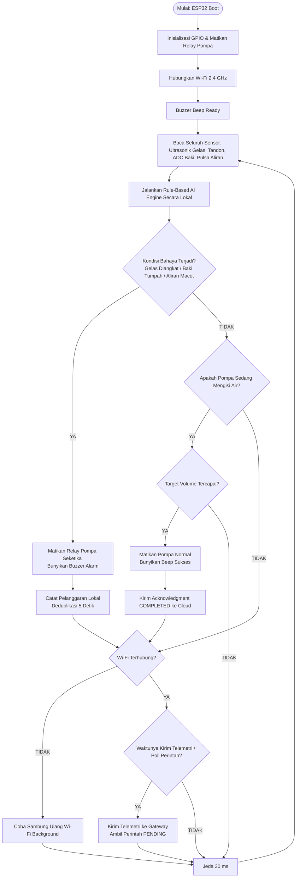
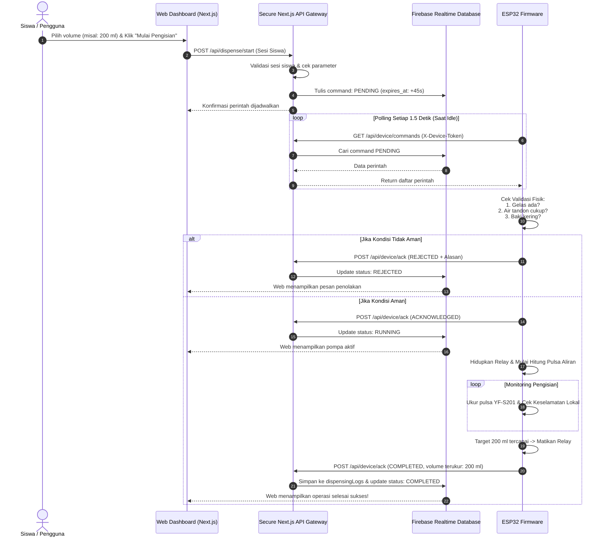

# DIAGRAM ALIR SISTEM (SYSTEM FLOWCHART)
## Smart Dispenser IoT — SMK Telkom Sidoarjo (XII SIJA UKL 3)

### 1. Flowchart Loop Utama ESP32 & Interlock Keselamatan

---

### 2. Flowchart Siklus Perintah Dispensing dari Web

